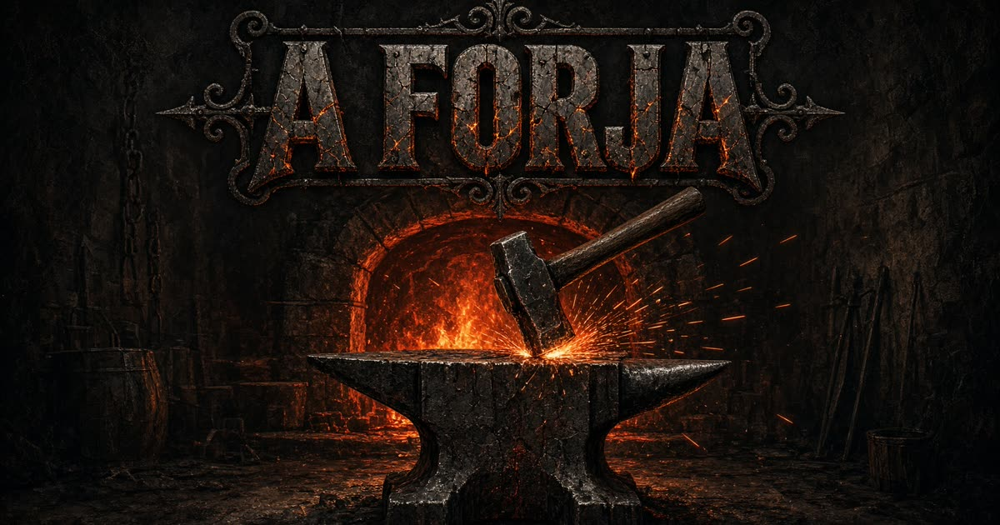

# FioForja

Jogo de forja medieval no navegador. Você desenha a espada, aquece o ferro, martela no ritmo certo e tempera o gume — a força de cada golpe decide se nasce uma obra-prima ou um ferro torto.



## Versão POV e desempenho — 13/10/2026

A forja agora mantém a lâmina visível sobre uma bigorna inclinada, com tenaz à esquerda e martelo à direita. Golpes perfeitos acendem inscrições gravadas; a lâmina recebe gradiente térmico e acabamento conforme sua qualidade. A montagem final usa lâmina, inscrição, empunhadura e guarda/pomo independentes.

O desempenho combina **60% ritmo + 20% controle térmico nos golpes + 20% têmpera**. Qualidade e raridade são mostradas separadamente.

| Rank | Score | Recompensas |
|---|---|---|
| S | 95–100 | Runas Ancestrais Tier 4, Damasco, metal estelar e empunhadura lendária |
| A | 80–94 | Runas elementais, liga temperada e guarda ornamentada |
| B | 60–79 | Ferro refinado, couro de artesão e runa menor |
| C | 50–59 | Ferro refinado e sucata |
| Falha | <50 ou quebra | Apenas sucata reutilizável |

A inspeção permite zoom, giro e leitura do histórico dos golpes. Abra o baú e receba cada recompensa uma única vez; os desbloqueios permanecem nos próximos projetos. O Compêndio mostra descobertas e permite refinar sucata. O Legado guarda recordes e exporta o arsenal. Saves antigos migram sem excluir armas; não há mais descarte automático ao atingir 24 peças.

## Como jogar

1. **Desenhe a arma** — escolha perfil, aço, cabo, guarda, pomo e uma inscrição.
2. **Aqueça** — leve o metal à janela de cor certa (cada aço pede uma temperatura).
3. **Martele** — segure para carregar a força e solte no ponto doce. Golpe fraco não forma; golpe forte demais empena.
4. **Tempere** — mergulhe a lâmina na hora certa.
5. **Guarde** — a espada entra no arsenal com nota de qualidade.

### Controles

| Ação | Mouse / toque | Teclado |
|---|---|---|
| Aquecer / martelar / temperar | Segurar e soltar | Espaço ou clique |
| Reaquecer no meio da forja | Botão **Reaquecer** | R |
| Silenciar | Ícone de som | — |

No celular, tudo é por toque: segure para carregar o martelo, solte para bater.

## Oficina

**Perfis:** espada curta, longa, claymore, alfange, sabre.

**Aços:** ferro (perdoa erros), aço, damasco (janela estreita), meteorito (estrelas no gume).

**Cabo e ferro:** couro, linho, fio de ouro ou osso; guardas em cruz, curva, asas ou anel; pomos em disco, esfera, lobo ou cruz.

**Inscrição:** texto gravado no ricasso, com opção de runas.

A qualidade final soma calor, precisão dos golpes e têmpera. Espadas ficam salvas no navegador.

## Rodar localmente

```bash
npm ci
npm run dev
```

Abre em `http://localhost:8080`.

```bash
npm run build      # produção
npm run typecheck  # tipos
npm run test       # scripts, auth, app-data e núcleo do jogo
npm run lint       # análise estática
```

## Stack

- React 19 + TypeScript
- TanStack Start / Router
- Vite 8 + Tailwind CSS 4
- Canvas 2D para a forja, a mão e a espada

Feito para o navegador — sem conta, sem servidor de jogo. O arsenal vive em `localStorage`.

O comando `build` também executa a migração de banco definida em `package.json`; consulte o ambiente antes de usá-lo como simples checagem local. O comando `test` inclui `src/game/game.test.ts`. Quatro verificações específicas das skills do template são ignoradas quando esses arquivos externos não existem.

Para trabalho por agentes, comece em [docs/AI-START-HERE.md](docs/AI-START-HERE.md). O estado documentado é específico ao snapshot indicado em [docs/PROJECT-STATE.md](docs/PROJECT-STATE.md).

## Teste de navegador

```bash
npx playwright install chromium
npm run test:browser
```

Esse teste inicia um servidor local, percorre a forja por teclado, inspeciona e recebe recompensas, recarrega o save, testa falha e reciclagem e confere três proporções de tela. Capturas e relatório saem em `/tmp/fioforja-qa`; use `FIOFORJA_QA_DIR` para outro destino, `FIOFORJA_TEST_URL` para um servidor já aberto ou `FIOFORJA_BROWSER_PATH` para um Chromium instalado. O teste substitui somente scripts externos do template e a folha do Google Fonts; não injeta resultados ou estado na simulação.

Arte própria: `public/game/anvil-pov.png` e `public/game/reward-chest.png`, geradas para esta versão. A renderização é Canvas 2D; não é uma câmera/mesh 3D nem uma reprodução fotorrealista completa do vídeo.
