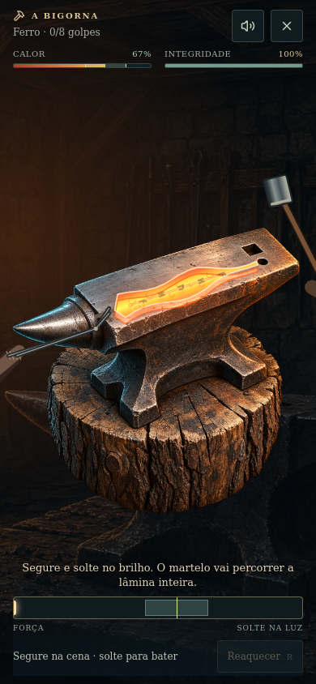
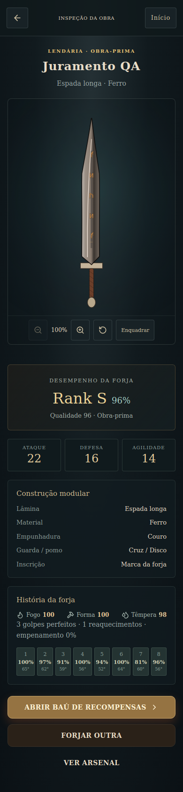
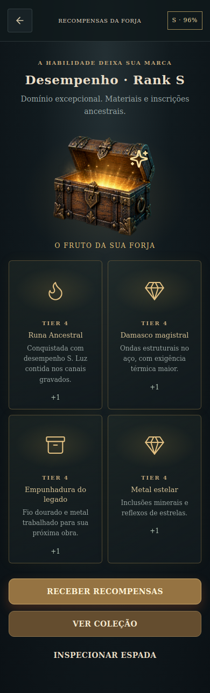

# Verificação — FioForja POV e desempenho

Data: 13/10/2026. Base: main `7758749`. Escopo: brief do usuário, com quatro imagens e vídeo de referência.

## Resultado

- `npm ci --ignore-scripts --no-audit --no-fund`: instalação reproduzível após corrigir entradas ausentes no lockfile.
- `npm test`: 261 PASS, 0 FAIL, 4 SKIP. São 193 verificações de scripts, 55 de auth/app-data e 13 do core. Os quatro skips só verificam documentação de skills externas do template ausentes no repositório; não são testes de gameplay omitidos.
- `npm run typecheck`, `npm run lint`, `npm run build`: PASS. Build executou sua migração configurada e registrou que DATABASE_URL não está definido; o jogo não usa servidor para persistir o arsenal.
- `npm run test:browser`: PASS. Resultado detalhado em [browser-result.json](pov-forge/browser-result.json).

O baseline original foi executado em cópia limpa e apresentava 16 falhas da infraestrutura de testes. A suíte de head metadata passou a usar diretório temporário em vez do título/arte reais do FioForja; testes do wrapper receberam fixtures explícitas; o teste de configuração ausente verifica o default fail-closed existente. Não houve alteração de política de autenticação. Foram removidos uma diretiva ESLint sem efeito e um catch vazio recebeu comentário.

## Provas no navegador

Chromium headless local. A sessão de teste usa somente eventos reais de teclado e cliques, leituras de DOM e localStorage. Não injeta espadas, rank, tempo ou resultados na simulação.

- Projeto modular, opção de runas, aquecimento, 8 golpes, reaquecimento e têmpera.
- Fluxo de sucesso S/A conforme a execução, zoom e enquadramento na inspeção.
- Claim e desbloqueios persistem após reload; baú já recebido não pode ser reivindicado de novo.
- Fluxo de falha F concede somente sucata; reciclagem consome 3 e produz 1 ferro refinado.
- 390×844, 360×640, 1440×900 e 844×390; sem overflow horizontal.
- Sem erros JavaScript da aplicação. O teste substitui o script remoto do template e a folha Google Fonts por respostas vazias; portanto a fonte remota e o chrome de terceiros não são certificados.

O navegador cloud bloqueou terminal.local neste ambiente. A alternativa foi um Chromium local disponível, com shim temporário de enumeração de interfaces de rede apenas no processo de teste. Esses ajustes de ambiente não integram o código do produto.

## Comparação visual e correções

As referências representam direção de produto/arte, não contrato de reprodução fotorrealista pixel a pixel. A entrega usa Canvas 2D, arte própria da bigorna/baú e módulos desenhados em tempo real. Não há meshes, câmera 3D nem shaders de GPU.

Revisão independente identificou corte da peça na têmpera landscape e perda de release ao mover foco para botão. Foram corrigidos com pose térmica limitada ao enquadramento, movimento de mergulho, canvas focável e liberação de carga independente do alvo do keyup. Testes de geometria e navegador passaram depois das correções.

A verificação de reload identificou divergência de hidratação por leitura de storage no primeiro render. Agora o primeiro frame é determinístico e o save é carregado após mount. A inscrição rúnica recebeu traços geométricos para evitar quadrados em aparelhos sem fontes Runic. O feedback de reaquecimento agora anuncia quando o material chega ao ponto.

## Arte gerada

Ferramenta built-in de geração de imagens. Arquivos usados: `public/game/anvil-pov.png` e `public/game/reward-chest.png`.

- Bigorna: sprite transparente, ferro e aço com marcas e reflexos naturais, câmera inclinada cerca de 40°, superfície ampla, sobre tronco, sem lâmina/mão/ferramentas. Luz quente à esquerda e fria à direita. O sprite é espelhado pelo Canvas para alinhar a mesa à direção da lâmina.
- Baú: sprite sheet transparente 2:1, mesmo baú de carvalho/ferro envelhecido em dois frames, fechado e aberto com luz dourada. Sem texto, itens ou fundo.

## Limites

Não foi validado no Android físico do usuário nem confirmado deploy público. A Galeria completa de seis áreas, Relíquias assinadas, economia, combate e upgrades da imagem continuam fora desta entrega. A coleção armazena desbloqueios e quantidades, sem cobrar material por tentativa. Balanceamento de dificuldade exige partidas humanas.
