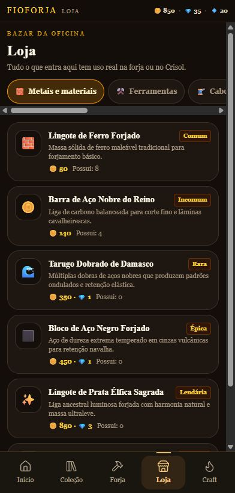
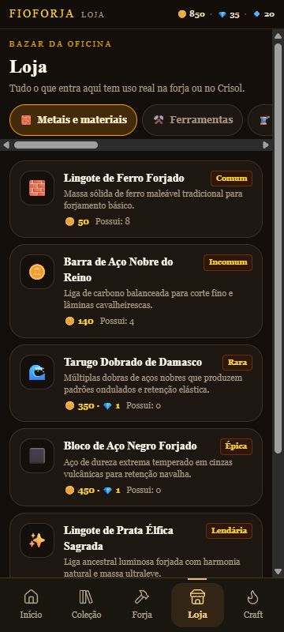
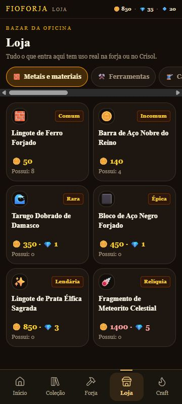

# M02A — Loja Essencial

**Resultado: PASS técnico; avaliação visual no Poco pendente.** Data: 26/10/2026. Branch: `codex/shop-essential-m02a`. Base funcional: `1bcc1ea88ad339df4ce56df45ce2794c18ecf92d` (revisão Codex 08). Worktree: `C:\Users\phped\.codex\worktrees\shop-essential-m02a\FioForja`.

## Escopo e execução

Plano executado: capturar a Loja original → condensar cards → verificar apresentação e compra real → executar testes afetados → preservar APK anterior e construir 0.2.3 → revisão final do diff. A pesquisa consultada foi `docs/research/REA-UX-HARVEST.md` em `codex/rea-ux-harvest@7c9bcc3`; sua recomendação de reorganizar categorias fica reservada à M02B.

O único arquivo de jogo alterado é `src/game/screens/ShopScreen.tsx`. Cards agora usam grade responsiva com largura mínima de 9rem, duas colunas nas duas viewports exigidas e uma coluna quando não couberem duas. Mostram ícone original, raridade, nome completo, preço e posse. Descrições ficam na ficha existente, que acrescenta posse e rótulo de categoria em português. O botão de compra continua chamando o mesmo `onPurchase`.

`Venda/forje` foi substituído pelo déficit calculado por moeda: “Você precisa de mais 550 ouro.”, ou “Você precisa de mais 1950 ouro e 16 rubis.”. O botão continua desabilitado quando o saldo é insuficiente. Não foi adicionado outro caminho de compra nem opção nova.

Preservados: catálogo e preços em `shop.ts`; oito categorias, sua ordem e seus filtros; transações, save, economia, fusão, Forja, Arsenal, Craft e `GameApp`; ícones e assets existentes. `package.json`, raiz de `package-lock.json` e `android/app/build.gradle` receberam somente identificação de versão **0.2.3/código 5**. Nenhuma dependência mudou.

## Comparação visual

Navegador in-app, DPR 1. Antes/depois usam os mesmos seis materiais e save inicial separado: 850 ouro, 35 rubis, 8 ferro, 4 aço. As compras foram feitas em outra origem de teste, sem usar dados do proprietário. As dimensões CSS foram lidas do DOM; as quatro imagens finais têm exatamente as dimensões indicadas. Capturas intermediárias com dimensão incorreta foram substituídas antes da entrega.

| Medida | Antes 392×819 | Depois 392×819 | Antes 360×800 | Depois 360×800 |
|---|---:|---:|---:|---:|
| Produtos inteiros acima da barra inferior | 5 | **6** | 4 | **6** |
| Colunas | 1 | 2 | 1 | 2 |
| Rolagem vertical dos materiais, conteúdo/área útil | 822/713 px | **713/713 px** | 880/694 px | **694/694 px** |
| Texto da lista completa, palavras | 141 | **76** | 141 | **76** |
| Tamanho do nome | 14 px | 14 px | 14 px | 14 px |

Contagem: card inteiro significa retângulo completamente dentro da área acima da navegação fixa, sem rolar. Texto da lista inclui todos os seis cards, não somente a parte visível. São 65 palavras a menos, ~46%, sem abreviar nomes ou remover dados da ficha. Os cards de materiais medem 180×156 px em 392 e 164×156 px em 360; a menor largura observada nas oito categorias foi 156,5 px. O card inteiro é o alvo de toque. Nomes quebram linha sem clamp; preços preservam ambas as moedas. Não houve overflow de card nos 35 produtos visitados em 360 px.

| Antes 392×819 | Depois 392×819 |
|---|---|
|  |  |

| Antes 360×800 | Depois 360×800 |
|---|---|
|  |  |

Outras provas: [mensagem antiga](evidence/before-insufficient-360.jpg), [nova mensagem](evidence/after-insufficient-360.jpg), [falta das duas moedas](evidence/insufficient-both-currencies.jpg), [ferramentas](evidence/category-tools-360.jpg), [receitas](evidence/category-recipes-360.jpg). Medições: [antes](evidence/before-metrics.json), [depois](evidence/after-metrics.json), [oito categorias](evidence/category-checks.json).

## Fluxo real e testes

Interação pela UI real; nenhum callback/transação foi invocado por script e nenhum save foi injetado. Leitura de carteira e estoques pela interface. Asserções compararam os resultados esperados; detalhes em [flow-results.json](evidence/flow-results.json).

1. **Abrir e identificar — PASS:** Loja acessível pela barra; seis materiais reconhecíveis na lista inicial final.
2. **Consultar detalhes — PASS:** tocar no card abre a [ficha do ferro](evidence/flow-01-detail.jpg), com descrição, atributos, posse 8, preço 50 e botão Comprar visível.
3. **Comprar e receber — PASS:** [ferro comprado](evidence/flow-02-purchased.jpg), ouro 850→800, ferro 8→9; Damasco comprado por 350 ouro + 1 rubi, ouro 800→450, rubis 35→34, Damasco 0→1.
4. **Saldo insuficiente — PASS:** [Meteorito](evidence/flow-03-insufficient.jpg) bloqueado, faltam 950 ouro; Marreta bloqueada, faltam 1950 ouro e 16 rubis. A transação não foi tentada com botão desabilitado; a recusa pelo motor é coberta pelos testes existentes.
5. **Fechar/reabrir — PASS:** aba encerrada e reaberta na mesma origem; [carteira 450/34 e estoques 9/1](evidence/flow-04-persisted.jpg) preservados. Não é prova de force-stop Android.

- `node --experimental-strip-types --test src/game/mobile-integration.test.ts src/game/mobile-core-review.test.ts`: **65 PASS, 0 FAIL**.
- `node --test scripts/android-package.test.mjs`: **4 PASS**; identidade, entrada local, scripts e manifesto.
- `npm.cmd run typecheck`: **PASS**.
- `npm.cmd run lint`: **0 erros / 38 avisos herdados**, nenhum novo na tela alterada.
- `npm.cmd run apk`: **PASS**, inclui build mobile, assets, Capacitor, Gradle, manifesto e assinatura.
- Revisão final em contexto novo: nenhum bloqueador encontrado no diff ou nas evidências; não reexecutou testes já aprovados.

O baseline visual demonstrou a ausência da grade e a mensagem enganosa antes da alteração. Não foram criados testes unitários que apenas espelham CSS; a comparação e o percurso real verificam o comportamento alterado. A suíte completa histórica de 475 testes do Codex 08 não foi reexecutada: esta rodada executou os testes afetados acima, sem somar seus resultados aos históricos.

## APK entregue e preservação

`C:\Users\phped\Documents\FioForja\APK\FioForja-teste.apk` e `FioForja-debug-v0.2.3.apk`, **12.129.945 bytes**. SHA-256: `70a1343076fedbc2762efa157b2d505815a7c11aa5de3b2b4658c5450c8d32b1`. Cópias no worktree e no destino automático do checkout principal têm o mesmo hash.

0.2.2/código 4 e seus metadados foram copiados antes da substituição para `C:\Users\phped\Documents\FioForja\APK\Backups\pre-M02A-20261026\requested` e `primary`. Hash anterior: `d528b890f9f83a2299f105874084bf8e7f8717e5c86a5cf920b74a393fc40f56`.

Identidade preservada: `com.projetofio.fioforja`, origem `https://localhost/`, minSdk 24 e targetSdk 36. Certificado SHA-256 igual no APK anterior e no novo: `29896d7ad281e0f642a44d513b2b277a3e1723de2df0d796ea0eff1a8af195bc`. Assets locais e ausência de permissão de internet foram verificados pela infraestrutura. `BUILD-INFO` declara base `1bcc1ea` + alterações não commitadas; não atribuir o binário a um HEAD limpo. Os blobs Git das fontes empacotadas constam em [verification.json](verification.json).

Não houve instalação no Poco nesta missão. Mesma identidade/certificado permitem atualização compatível; preservação de dados durante atualização **em execução**, offline físico, toque e aprovação visual deste APK permanecem **NOT_PROVEN**. O save e as transações não foram modificados.

## Problemas, limites e M02B

- As categorias ainda exigem arrasto horizontal e exibem barra de rolagem. Isto é deliberadamente preservado para comparar **M02B** separadamente.
- Ferramentas e receitas ainda têm rolagem vertical por sua quantidade ou pelo painel de equipamento; “seis sem rolar” refere-se aos materiais iniciais.
- O sucesso da compra aparece em toast e mensagem inline, mecanismo herdado; feedback pode aumentar temporariamente a altura da lista. Não foi redesenhado nesta missão.
- DPR 1 e navegador desktop em viewport mobile não provam legibilidade/tato no Poco nem acessibilidade completa. Emojis variam entre plataformas.
- Antigravity continua isolado em sua worktree de movimento; nenhum de seus fontes foi alterado. Os dois documentos locais de filosofia em `rea-ux-harvest` permanecem preservados fora desta branch. Não houve merge ou push.

**Recomendação M02B:** manter estes cards e a transação; comparar somente a descoberta das oito categorias, com as tarefas “achar aço”, “achar catalisador” e “achar uma receita”. Medir gestos e erros de localização sem voltar a acrescentar descrições à grade. M02B não foi iniciada.

## Atualização posterior no Poco — 26/10/2026

Após o encerramento acima, o proprietário conectou o Poco e autorizou a instalação. `adb install -r` atualizou **0.2.2/código 4 → 0.2.3/código 5** com `Success`; `firstInstallTime` permaneceu inalterado. Backup privado dos dados do app foi preservado em `APK/evidence/M02A-poco-update-20261026`, ignorado pelo Git. Os hashes dos **nove arquivos de Local Storage foram idênticos antes/depois da instalação**, antes de abrir o app. `MainActivity` abriu com status `ok`, e a captura física mostrou a tela Início com o progresso existente. Isso comprova atualização e abertura no aparelho; não comprova ainda usabilidade da nova Loja, compras, offline, áudio ou aceitação visual nesta versão. Nenhuma compra ou forja foi executada no inventário do proprietário.
