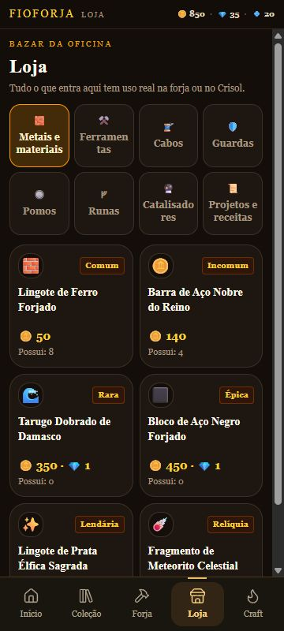
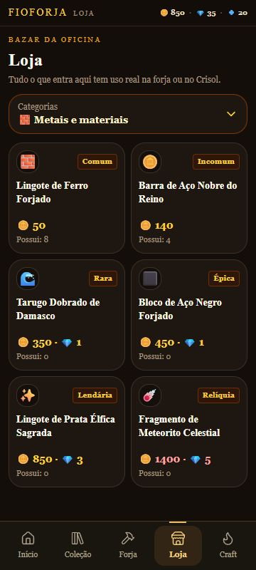
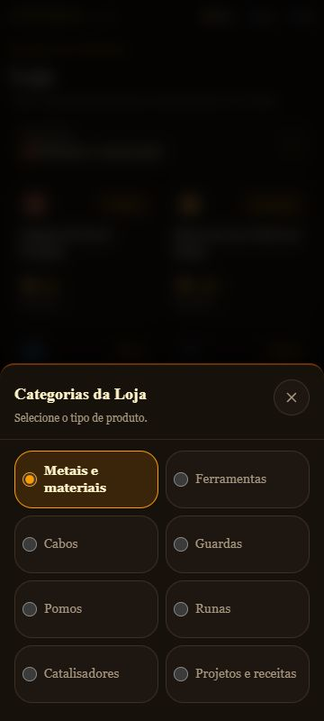
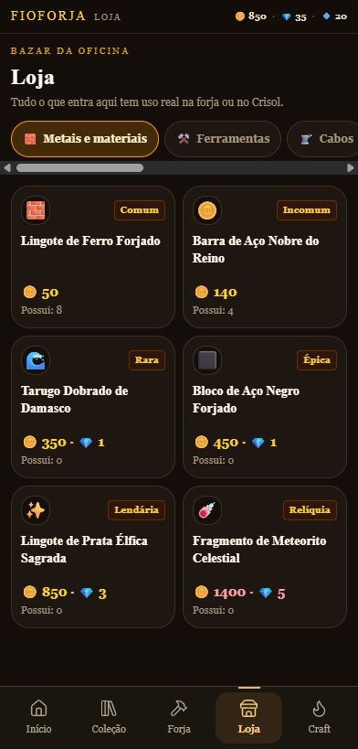
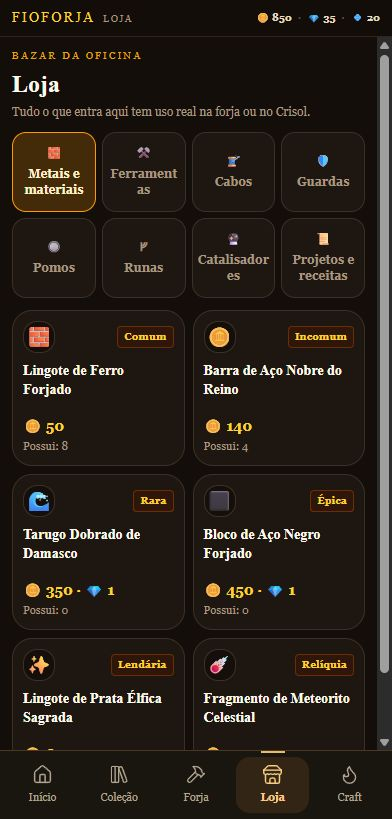
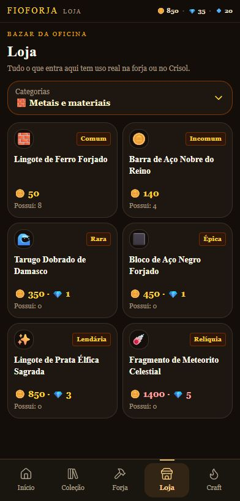

# M02B — Categorias intuitivas da Loja

**Resultado:** PASS técnico; navegação M02B candidata à avaliação humana no Poco. **Data:** 26/10/2026. **Branch:** `codex/shop-categories-m02b`. **Base:** `d332233eb75a607d6454d4775753a3098799a2f8`, que contém a M02A `bc3f364` e seu registro posterior de instalação no Poco. Worktree: `C:\Users\phped\.codex\worktrees\shop-categories-m02b\FioForja`.

**Feedback do proprietário recebido nesta missão:** cards, nomes e preços da M02A ficaram claros e legíveis no Poco. Isso orientou sua preservação; não constitui aprovação da nova navegação M02B.

## Comparação e decisão

A pesquisa M01 foi consultada no worktree `rea-ux-harvest`, commit `7c9bcc3`. Testei A e B na Loja real em worktree isolada, com os mesmos seis materiais, 850 ouro, 35 rubis, ferro 8/aço 4. Não houve compra durante a comparação. A variante A usou quatro colunas, duas linhas e nomes com quebra de palavra, preservando cards e filtros M02A. Foi substituída por B antes da entrega; não há seletor experimental no jogo final. As capturas e medidas de ambas estão preservadas abaixo.

Navegador in-app, DPR 1. As imagens têm exatamente 360×800 ou 392×819 px, correspondentes à viewport CSS lida do DOM. [Baseline](evidence/baseline.json), [A](evidence/alternative-a.json) e [B](evidence/alternative-b.json) preservam as medidas.

| Critério | M02A: faixa horizontal | A: quatro colunas × duas linhas | B: botão Categorias + painel |
|---|---|---|---|
| Descoberta das oito opções | ~2,5 aparecem; faixa de 1007 px | Todas na tela inicial | Botão explícito; todas aparecem ao abrir |
| Runas / Catalisadores / Projetos, a partir da lista | Arrasto(s) + 1 toque | 1 toque | 2 toques, sem arrasto |
| Altura permanente das categorias | 59 px | 166 px | **56 px**; painel aberto ~396 px |
| Materiais inteiros em 360×800 | 6 | 4 | **6** |
| Materiais inteiros em 392×819 | 6 | 4 | **6** |
| Nomes de categorias | Legíveis, mas parcialmente fora da tela | Completos; Ferramentas/Catalisadores quebram dentro da palavra | Completos, legíveis no painel |
| Alvo de categoria em 360 | Chip de 40 px de altura | ~76×80 px | **~160×64 px**, botão inicial 336×56 px |
| Identificação ativa | Chip selecionado | Botão selecionado | Nome atual no botão; radio marcado e destaque no painel |

**Escolha técnica: B.** O toque adicional tem custo explícito, mas preserva dois materiais inteiros e evita nomes espremidos. O painel mostra as oito opções em um único nível, com seleção imediata; não exige rolagem horizontal. A grade A perde cerca de um terço dos produtos inteiros da primeira tela. Uma consulta pontual ao Kev favoreceu B e coincidiu com esta leitura das medidas; é conselho, não evidência de usabilidade nem autorização humana.

| A — 360×800 | B — 360×800 | Opções de B — 360×800 |
|---|---|---|
|  |  |  |

| M02A — 392×819 | A — 392×819 | B — 392×819 |
|---|---|---|
|  |  |  |

Também disponíveis: [baseline 360](evidence/baseline-360.jpg) e [painel B em 392](evidence/panel-392.jpg).

## Implementação e preservação

Somente `src/game/screens/ShopScreen.tsx` mudou no jogo. O botão mostra “Categorias”, o nome e o ícone da categoria atual; usa `aria-haspopup="dialog"` e estado expandido. O painel reutiliza `Sheet` existente, com oito radios nativos rotulados por nomes canônicos. O rótulo inteiro é clicável; foco visível, teclado, Escape e seleção ativa são acessíveis. O conteúdo acrescenta padding com `env(safe-area-inset-bottom)`; max-height e rolagem interna vêm do Sheet. A área segura física no Android não foi medida nesta rodada.

Preservados integralmente: JSX/estilo dos cards M02A, nomes completos, preços, moedas, estoque, ícones, catálogo, oito IDs e filtro `shopCategoryOf`, compra por `onPurchase`, transações, inventário e save. `GameApp`, navegação global, `Sheet`, Forja, Craft e Coleção não foram editados. Alterações de pacote/lockfile/Gradle são somente versão **0.2.4/código 6**, sem mudar dependências.

O tratamento de Voltar é local à Loja ativa e reutiliza o histórico de seções existente: abrir um painel empilha uma entrada com `fioSection: "shop"`; fechar consome essa entrada; Voltar primeiro fecha o painel e só depois sai da Loja. Foco retorna ao controle de origem. Categoria permanece após compra e navegação na mesma sessão; ao reabrir completamente o jogo, volta a Metais e materiais, comportamento herdado sem novo campo no save.

## Verificações executadas

Prova por UI real e asserções, sem chamar callbacks/transações por script nem injetar saves. Dados do proprietário não foram usados. [Registro do fluxo](evidence/flow-results.json) separa falhas iniciais e resultados finais; os 16 acessos de categoria são duas larguras × oito categorias.

1. **Abrir Loja — PASS:** botão Categorias e lista M02A visíveis.
2. **Encontrar/selecionar as oito categorias — PASS:** 16 verificações, filtros com 6/5/3/5/3/5/1/7 produtos, na mesma ordem de IDs. Runas, Catalisadores e Projetos alcançados em dois toques.
3. **Abrir produto — PASS:** [ficha Fehu](evidence/product-detail-360.jpg) conserva nome, posse, preço 320 ouro + 1 rubi, atributos, destino e confirmação.
4. **Comprar/entregar/retornar — PASS:** Fehu 0→1, ouro 850→530, rubis 35→34; [categoria Runas mantida](evidence/purchased-rune-360.jpg). Catalisador 0→1, ouro 530→130, rubis 34→33; categoria Catalisadores mantida. A ficha fecha para a lista.
5. **Alternar categoria — PASS:** após comprar Fehu, foi possível comprar catalisador pelo mesmo seletor; nenhum filtro altera o inventário.
6. **Fechar/reabrir jogo — PASS no navegador:** aba encerrada e reaberta na mesma origem; [runa](evidence/persisted-rune-360.jpg), [catalisador](evidence/persisted-catalyst-360.jpg) e saldo 130/33 persistiram. Não equivale a force-stop Android.
7. **Voltar — PASS no navegador:** fecha ficha mantendo Runas/Loja; fecha Categorias mantendo Loja; próximo Voltar vai ao Início, sem entradas excedentes após fechamentos repetidos.
8. **Acessibilidade básica — PASS no envelope:** Enter abre; ArrowDown no radio seleciona a próxima categoria; Escape fecha; foco retorna ao botão; radios têm nomes e estado marcado. Leitor de tela e acessibilidade completa não foram testados.

Testes e checks: **65 PASS / 0 FAIL** em `mobile-integration.test.ts` + `mobile-core-review.test.ts`; **4 PASS** em `scripts/android-package.test.mjs`; `npm.cmd run typecheck` PASS; `npm.cmd run lint` **0 erros / 38 avisos herdados**; `npm.cmd run apk` PASS (build mobile, assets locais, sincronização Capacitor, Gradle, manifesto e assinatura). A suíte completa histórica não foi repetida. Logs de execução ficam locais/ignorados; resumo em [verification.json](verification.json).

Revisão final em contexto novo: nenhum bloqueador concreto no diff, no histórico local dos painéis ou nas evidências. Não reexecutou testes já aprovados.

## Problemas detectados e corrigidos

- **Herdado, reproduzido na base:** Voltar com a ficha aberta navegava ao Início. **RED→GREEN:** agora fecha a ficha e mantém a Loja; sem mudança no handler global.
- **Durante o ensaio B:** tocar no radio já marcado não emitia change e deixava o painel aberto. **RED→GREEN:** o toque na categoria ativa também fecha o painel.
- **Limite de A:** nomes longos exigiam quebra dentro da palavra para caber em quatro colunas; B preserva sua leitura sem consumir altura permanente adicional.
- Nenhuma regressão funcional foi encontrada nas verificações executadas. Isso não é prova de todos os dispositivos/estados.

## APK e encerramento

Entregue em `C:\Users\phped\Documents\FioForja\APK\FioForja-teste.apk` e `FioForja-debug-v0.2.4.apk`, **12.130.785 bytes**, SHA-256 `460634f125cdd4f027457967043499085f499080b0bbca450e3fee51c26a659c`. Cópias no worktree e no destino automático do checkout principal têm o mesmo hash.

Antes da substituição, 0.2.3 e metadados foram preservados em `APK\Backups\pre-M02B-20261026\requested` e `primary`, na pasta habitual de entrega. Hash anterior: `70a1343076fedbc2762efa157b2d505815a7c11aa5de3b2b4658c5450c8d32b1`. Certificado SHA-256 igual antes/depois: `29896d7ad281e0f642a44d513b2b277a3e1723de2df0d796ea0eff1a8af195bc`. App ID, origem local, assets e manifesto offline preservados. Build declara base `d332233` + alterações não commitadas; os blobs Git das fontes empacotadas constam na verificação. Caminhos gerados pelo Capacitor para a instalação local de dependências foram removidos do diff após o build.

**Pendências:** instalação e teste deste APK no Poco; Voltar físico, área segura efetiva, toque, offline em execução e aprovação humana da M02B. O feedback positivo recebido refere-se aos cards M02A. O APK instalado no aparelho não foi substituído nesta missão; nenhum save do usuário foi escrito. Fonte original, worktrees concorrentes e alterações documentais preexistentes preservados. Sem merge na main, push ou início de outra missão.
