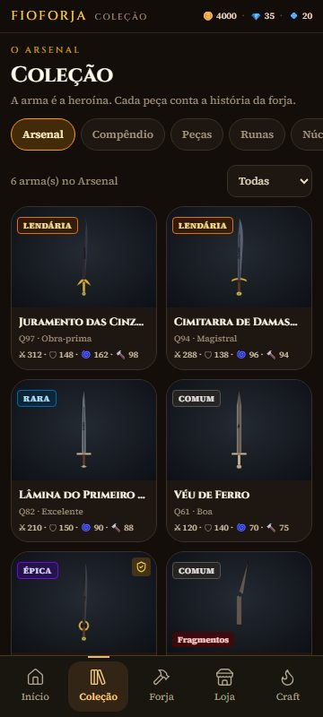
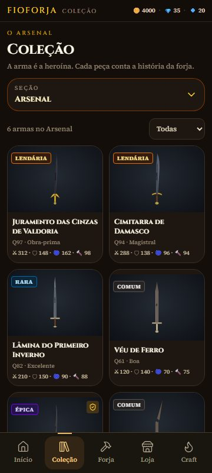
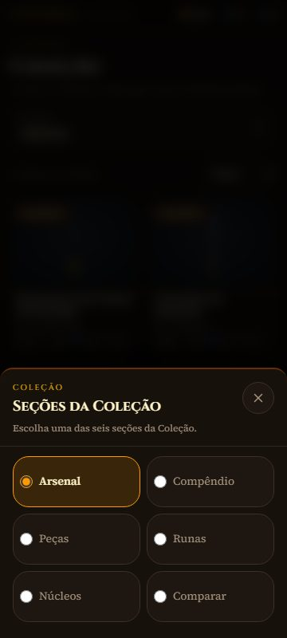
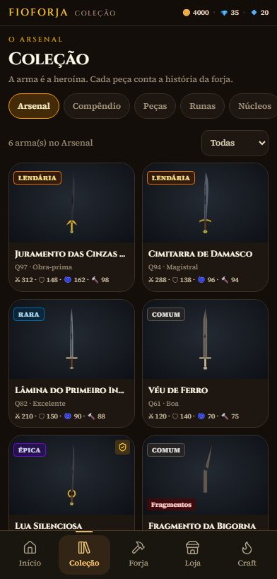
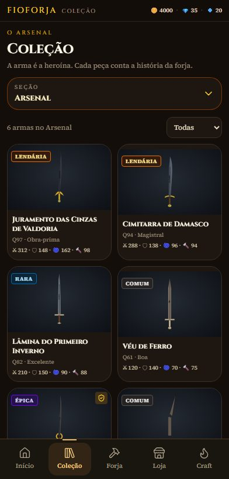
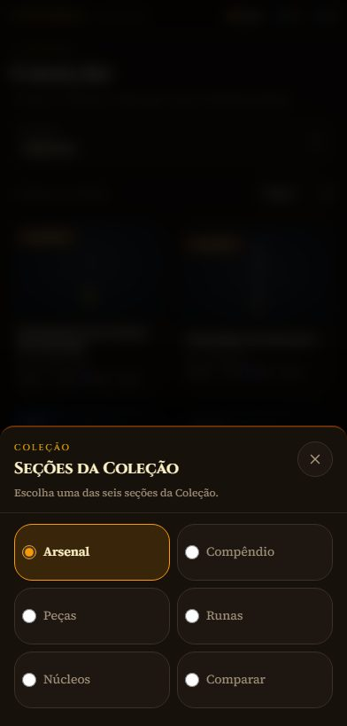

# M04 — Coleção intuitiva

**Resultado:** PASS técnico no navegador; seis seções descobríveis, Arsenal preservado como protagonista. **Data:** 27/10/2026. **Branch:** `antigravity/collection-intuitive-v1`. **Base:** `0806758bea1d011eb0a859745760183a5499d55d` (M03A — preparação visual refinada). **Worktree:** `C:\Users\phped\Projetos\FioForja\worktree-collection-intuitive-v1`. **Commit local:** um único commit nesta branch; hash em `git log -1`. Sem push, merge ou APK.

## 1. Diagnóstico

A Coleção usava uma faixa horizontal de seis chips. Em 360×800, a faixa media 501 px dentro de uma viewport de 360 px: apenas **Arsenal, Compêndio, Peças e Runas** ficavam inteiros; **Núcleos e Comparar** ficavam fora da tela. Em 392×819, **Comparar** continuava oculto e **Núcleos** aparecia só parcialmente. Não havia gradiente, seta ou outro sinal de que a faixa rolava; o chip cortado era a única pista.

| Medida | 360×800 | 392×819 |
|---|---:|---:|
| Conteúdo da faixa / viewport | 501 / 360 px | 501 / 392 px |
| Excesso horizontal | 141 px | 109 px |
| Seções inteiras visíveis | 4 de 6 | 4 de 6 |
| Seções fora da tela | Núcleos, Comparar | Comparar (Núcleos parcial) |
| Cartões de espada inteiros | 4 | 4 |
| Nome longo no cartão | 1 linha, cortado | 1 linha, cortado |

Ao escolher uma seção distante, a própria faixa rolava e escondia Arsenal/Compêndio, dificultando o retorno. O nome "Juramento das Cinzas de Valdoria" aparecia como "Juramento das Cinzas…"; "Lâmina do Primeiro Inverno" como "Lâmina do Primeiro In…".

O filtro vazio era enganoso: com seis armas no Arsenal e o filtro **Relíquia** sem resultados, a tela dizia "Nenhuma lâmina aqui ainda." e oferecia **Forjar a primeira**. O mesmo texto aparecia na coleção realmente vazia, sem distinguir os dois estados. A contagem dizia apenas "0 arma(s) no Arsenal".

As ações de inspeção existentes funcionavam: prévia grande, nome completo no painel, raridade, qualidade, P.ATK/DEF/AGI/DUR, montagem, proteção, refino e comparação. Os quatro botões "Instalar" da montagem não tinham rótulo acessível próprio; foram rotulados nesta missão.

## 2. Alternativas comparadas

Testei A e B no código real, em worktree isolada, com o mesmo save sintético de seis armas e as mesmas duas viewports. As variantes não ficaram no jogo final; as capturas e métricas estão preservadas.

| Critério | Base: faixa horizontal | A: grade 3×2 | B: seletor visível + painel |
|---|---|---|---|
| Descoberta das seis seções | 4 visíveis; 2 fora da tela | Todas na primeira tela | Botão explícito; todas no painel |
| Toques até Runas/Núcleos/Comparar | rolagem + 1 toque | **1 toque** | 2 toques |
| Altura permanente | 40 px | 118 px | **56 px** |
| Cartões inteiros / terceira linha | 4 / 116 px visíveis | 4 / 38 px visíveis | **4 / 68 px visíveis** |
| Alvo de toque | 36 px de altura | 108×56 px | **56 px no seletor; 160×64 px no painel** |
| Seção ativa | chip selecionado | tile selecionado | **nome no botão + radio marcado** |
| Voltar | não fecha a faixa | não fecha a grade | **fecha o painel e permanece na Coleção** |
| Nomes longos | 1 linha, cortados | 1 linha, cortados | **2 linhas** |

**Escolha: B.** A grade A descobre as seis seções em um toque, mas instala uma parede permanente de seis botões (118 px) e reduz a terceira linha de espadas a 38 px. B custa um toque adicional, porém consome 56 px, deixa 68 px da terceira linha visíveis e mantém a arma como centro da tela. O padrão também é o mesmo já aprovado e usado na Loja (Categorias), o que reduz a curva de aprendizado. A decisão não foi validada com usuários; é uma leitura de medidas e da constituição visual, não um teste de usabilidade.

[Captura A em 360](evidence/alternative-a-360x800.jpg) · [Captura B em 360](evidence/alternative-b-360x800.jpg) · [Painel B em 360](evidence/panel-b-360x800.jpg)

## 3. Implementação

Somente a Coleção mudou. A faixa horizontal foi substituída por um botão de largura total, com o rótulo **Seção** e o nome da seção ativa, `aria-haspopup="dialog"` e `aria-expanded`. O painel reutiliza o `Sheet` existente: seis radios nativos em duas colunas, 64 px de altura, seleção destacada, legend para leitores de tela e padding de área segura inferior.

O seletor usa o histórico existente da Coleção. Abrir empilha uma entrada; escolher, fechar por X, Escape ou tocar no fundo consome essa entrada; **Voltar** fecha o painel e mantém a Coleção. O foco retorna ao botão de origem por `ref`, sem depender de `document.activeElement`. O painel só abre enquanto a Coleção está ativa.

O Arsenal ganhou:

- contagem que diferencia total e resultado filtrado ("0 de 6 armas · Relíquia");
- estado vazio real ("Nenhuma lâmina aqui ainda." + **Forjar a primeira**);
- estado de filtro sem resultado ("Nenhuma arma com raridade Relíquia." + **Mostrar todas as armas**), sem prometer uma forja desnecessária;
- nome em até duas linhas, com o nome completo em `title` e na inspeção;
- confirmação de proteção, montagem e refino dentro do próprio painel de inspeção;
- rótulos acessíveis nos botões repetidos de instalação.

Preservados: as seis seções e suas funções, a imagem real da espada via `WeaponPreview` (Clássico e DNA), nome/raridade/atributos, filtros, inspeção, favoritos/proteção, instalação, refino, comparação, inventário e save. `GameApp`, `Sheet`, `WeaponPreview`, `DesignScreen`, `ForgeCanvas`, transações e o formato do save não foram alterados.

Arquivos:

- `src/game/screens/CollectionScreen.tsx` — seletor, histórico, estados vazios, nomes e rótulos.
- `src/game/collectionSections.ts` — seis seções canônicas e helpers puros de contagem/estado vazio.
- `src/game/collectionSections.test.ts` — 4 testes.
- `package.json` — inclusão do novo teste no `npm test`.
- `docs/specs/collection.md` — nota desta missão.
- `experiments/M04-collection-intuitive/` — este relatório, ferramentas de captura e evidências.

O arquivo `CollectionScreen.tsx` foi normalizado pelo Prettier do projeto; parte do diff é só formatação de linhas preexistentes, sem mudança semântica. Nenhum arquivo compartilhado de UI foi alterado.

A única alteração em arquivo compartilhado é a lista de testes em `package.json`, necessária para que `collectionSections.test.ts` rode no `npm test`; dependências, scripts de execução e configuração não mudaram.

## 4. Capturas antes/depois

Viewport CSS, DPR 1, Edge headless 156, save sintético. As imagens têm exatamente 360×800 ou 392×819 px.

| 360×800 | Antes | Depois |
|---|---|---|
| Arsenal |  |  |
| Seções | faixa cortada |  |

| 392×819 | Antes | Depois |
|---|---|---|
| Arsenal |  |  |
| Seções | faixa cortada |  |

Outros estados finais: [Runas 360](evidence/final-runas-360x800.jpg) · [Núcleos 360](evidence/final-nucleos-360x800.jpg) · [Comparar 360](evidence/final-comparar-360x800.jpg) · [filtro sem resultado 360](evidence/final-filter-empty-360x800.jpg) · [filtro com resultado 360](evidence/final-filter-results-360x800.jpg) · [coleção vazia 360](evidence/final-empty-360x800.jpg) · [inspeção após montagem 360](evidence/final-inspection-installed-360x800.jpg) · [após refino 360](evidence/final-refined-360x800.jpg) · [coleção maior 360](evidence/final-large-360x800.jpg) · [Weapon DNA 360](evidence/final-arsenal-dna-360x800.jpg).

## 5. Verificação funcional

A prova usa UI real em contexto de navegador isolado, com save sintético. Não chama callbacks nem injeta transações por script. **70 verificações, 70 PASS, 0 FAIL** — 35 por viewport. O log completo está em [checks.json](evidence/checks.json); o resumo, em [verification.json](evidence/verification.json).

1. **Seis seções — PASS.** O painel mostra Arsenal, Compêndio, Peças, Runas, Núcleos e Comparar; todas as seis foram abertas pela UI em 360×800 e 392×819. Runas, Núcleos e Comparar exigem dois toques.
2. **Seção ativa — PASS.** O botão mostra "SEÇÃO Runas"/"SEÇÃO Núcleos"/"SEÇÃO Comparar" e o radio correspondente fica marcado.
3. **Inspeção — PASS.** Abre pelo cartão, mostra a prévia e fecha por X e por Escape. O botão Voltar do navegador não foi associado à inspeção; ver limites.
4. **Imagem, nome, raridade e atributos — PASS.** A arma sintética "Juramento das Cinzas de Valdoria" (Lendária, Q97) exibe P.ATK 312, DEF 148, AGI 162, DUR 98, iguais aos dados; a prévia usa o renderer Clássico.
5. **Favoritar/desfavoritar — PASS.** **Proteger** grava, mostra o escudo no cartão e persiste após reload; **Desproteger** remove e persiste após novo reload.
6. **Peças, Runas, Núcleos e Comparação — PASS.** Peças lista guarda e runa soltas; Runas exibe o compêndio; Núcleos mostra o núcleo e **Preparar na Forja**; Comparar calcula Δ por atributo (312→210 em ATK, −102).
7. **Persistência — PASS.** Instalar a guarda levou DEF 148→156 e a peça continuou após reload; refinar levou ATK 312→320 e DUR 98→100, mantidos após reload; o favorito foi preservado.
8. **Clássico e Weapon DNA — PASS.** Todos os percursos usam o Clássico; um contexto separado alternou para DNA e renderizou os seis canvas sem overflow.
9. **Sem corte/rolagem horizontal — PASS.** `scrollWidth − clientWidth` = 0 no documento e nas seções Arsenal, Runas, Núcleos, Comparar e Peças, nas duas viewports. Com 14 armas, a última é alcançável por rolagem vertical. Nomes longos usam duas linhas (32 px); nomes maiores que duas linhas ainda são limitados, com o texto completo em `title`/inspeção.
10. **Testes, typecheck e lint — PASS.** 499 testes descobertos, **492 PASS / 7 SKIP / 0 FAIL**; 4 testes novos. `npm run typecheck` PASS; `npm run build:dev` PASS. `npm run lint` **0 erros / 40 avisos**, nenhum nos arquivos alterados.

Também foram verificados: Escape e Voltar fecham o painel devolvendo o foco; a coleção vazia com filtro ativo continua sendo coleção vazia; o painel mostra as seis opções inteiras em 360×800 e 392×819 (topo 461/480 px, altura 339 px).

## 6. Problemas encontrados e corrigidos

- **Mensagem de filtro enganosa** (confirmada na base): "Nenhuma lâmina aqui ainda" com seis armas. Agora há dois estados distintos e uma ação para limpar o filtro. Teste unitário cobre a regra.
- **Nomes longos** eram cortados em uma linha. Passaram a duas linhas, mantendo o Arsenal compacto; a inspeção sempre mostra o nome completo.
- **Descoberta das seções**: a faixa horizontal escondia duas seções e não sinalizava rolagem. Substituída pelo seletor com painel único.
- **Confirmação invisível**: proteção, montagem e refino emitiam o aviso atrás do `Sheet`. O aviso agora aparece dentro da inspeção.
- **Botões "Instalar" repetidos** não tinham nome acessível distinto. Receberam `aria-label` com a peça e a espada.
- **Defeito do harness, não do jogo:** o primeiro teste de persistência falhava porque o `addInitScript` regravava o save a cada reload. Corrigi o harness para semear uma vez; repeti proteção, montagem e refino com persistência real. O resultado anterior foi descartado.

## 7. Riscos de integração e limites

- B exige **dois toques** para trocar de seção. A oferecia um, ao custo de 62 px permanentes e de uma parede de menus. A escolha prioriza a arma e a descoberta; não houve teste com jogadores.
- O painel é modal e escurece a Coleção enquanto está aberto. É o mesmo padrão da Loja; não impede a leitura das seis opções.
- O diff de `CollectionScreen.tsx` inclui reformatação Prettier de trechos não semânticos. Revisão com `git diff -w` isola a mudança funcional.
- A inspeção não ganhou entrada de histórico própria: continua fechando por X, Escape ou fundo, como na base. O Voltar físico enquanto ela está aberta não foi alterado nem faz parte desta entrega.
- Não há paginação no Arsenal; a grade cresce com rolagem interna, como antes.

## 8. UNKNOWN / NOT_PROVEN

- **NOT_PROVEN:** teste físico no Poco, toque real, legibilidade sob luz ambiente, área segura efetiva do Android/Capacitor e gesto Voltar físico. A área segura foi apenas preservada no CSS.
- **NOT_PROVEN:** leitor de tela (TalkBack/VoiceOver), contraste medido e navegação completa por teclado além de Enter/Escape/foco.
- **NOT_PROVEN:** desempenho sustentado e suavidade de rolagem com coleções muito maiores que 14 armas.
- **NOT_PROVEN:** persistência após force-stop do app; o teste foi reload de página no navegador.
- **NOT_PROVEN:** preferência humana entre A e B; as medidas não substituem um teste de usabilidade.
- **UNKNOWN:** nomes com mais de duas linhas continuam truncados visualmente; o texto completo existe em `title` e na inspeção.
- **UNKNOWN:** interação do histórico da Coleção com sequências de Voltar não cobertas (por exemplo, abrir o seletor, navegar para outra seção e usar o histórico do navegador em sequência longa). Os percursos testados — abrir/fechar, Escape, Voltar e seleção — passaram.

## 9. Encerramento

Nenhum APK foi instalado, publicado ou gerado. Não houve push, merge, alteração da main, de outros worktrees ou da branch de animação. A preparação M03A permaneceu intocada; a branch de animação da forja não foi incorporada nem alterada. O save do proprietário não foi lido nem escrito: todo o percurso ocorreu em contexto de navegador isolado com dados sintéticos.

## Reprodução

```bash
npm ci
node experiments/M04-collection-intuitive/capture/verify.mjs
```

O script sobe um Vite local em 8969, usa Edge headless (fallback Chrome), cria um contexto isolado, semeia o save sintético uma vez e grava `evidence/checks.json` e as capturas `final-*`. `capture/baseline.mjs` e `capture/compare.mjs` são ferramentas históricas da comparação: exigem o código da base ou da variante correspondente e não fazem parte de `npm test`.
